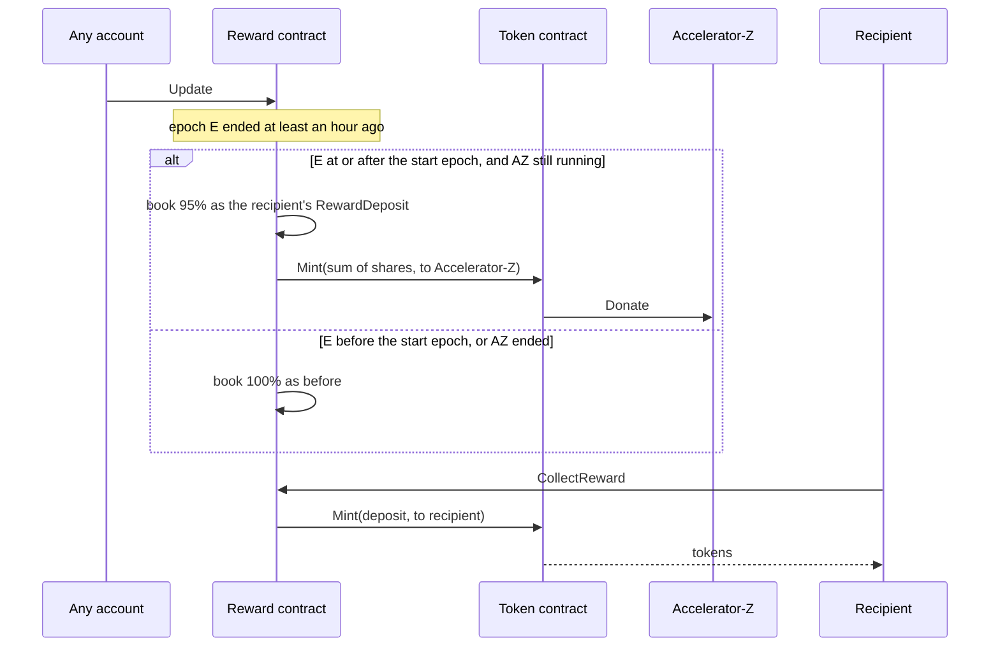

# Accelerator-Z Share — Overview & Deployment

## Summary

Accelerator-Z has received no protocol emission since genesis. Once `AcceleratorShareSpork` is enforced, **5% of every reward the protocol books is minted to Accelerator-Z instead of being booked to its recipient**, on all five reward streams and in both tokens. The share is taken from what is booked, not from what is scheduled, so emission the protocol already declines to mint (for missed momentums) stays unminted and issuance does not change. It implements the draft ZIP *Accelerator-Z Share of Protocol Rewards*.

| Stream | Token | Before | After |
|--------|-------|--------|-------|
| Pillar momentum reward | ZNN | 100% to the pillar, then its give split | 95% to the pillar, then its give split |
| Pillar delegation reward | ZNN | same | same |
| Sentinel reward | ZNN + QSR | 100% to sentinels | 95% to sentinels |
| Staking reward | QSR | 100% to stakers | 95% to stakers |
| Liquidity reward | ZNN + QSR | 100% to LP stakers, remainder to the liquidity contract | 95%, split the same way |

No method of the Accelerator-Z contract changes, and no method, RPC endpoint, ABI type or plasma charge is added.

---

## What Changed

| File | Change |
|------|--------|
| `common/types/spork.go` | `AcceleratorShareSpork` with placeholder id `0000...0003`, added to `ImplementedSporksMap` |
| `vm/vm_context/spork.go`, `interfaces.go` | `IsAcceleratorShareSporkEnforced()` |
| `vm/constants/embedded.go` | `AcceleratorSharePercentage = 5` and `AcceleratorShareOf(amount)`, which returns `share = floor(amount × 5 / 100)` and `rest = amount − share` |
| `vm/embedded/embedded.go` | `acceleratorShareSporkBit` in the variant table; `applyAcceleratorShareDiffs` replaces `Update` on the Pillar, Sentinel, Stake and Liquidity contracts in place |
| `vm/embedded/implementation/common.go` | The start epoch, the epoch gate, and an accumulator that sums the share per token across the epochs of one update and turns it into `Mint` descendants |
| `vm/embedded/implementation/pillars.go` | `UpdateSharedEmbeddedPillarMethod`; the share is taken from `BlockReward` and `DelegationReward` per pillar, before the give split |
| `vm/embedded/implementation/sentinel.go` | `UpdateSharedEmbeddedSentinelMethod`; the share is taken from the epoch totals, before the per-sentinel division, only when a sentinel is eligible |
| `vm/embedded/implementation/stake.go` | `UpdateSharedEmbeddedStakeMethod`; the share is taken from the epoch total, before the per-entry division, only when a stake entry is eligible |
| `vm/embedded/implementation/liquidity.go` | `UpdateSharedEmbeddedLiquidityMethod` (before `BridgeAndLiquiditySpork`) and `UpdateSharedRewardEmbeddedLiquidityMethod` (after it); the share is taken from the epoch totals before any split, always |
| `docker/devnet/genesis.json` | The spork, enforced from genesis |

Each shared method embeds the method it replaces, so syntactic validation and plasma are inherited unchanged. The unshared methods pass no accumulator and can never take a share.

### Unchanged

- `accelerator.go`: Accelerator-Z receives the share through its existing `Donate` path.
- `CollectReward` on every contract, and every `RewardDeposit` already booked.
- `PillarEpochHistory` and every RPC response shape; `getUncollectedReward` returns 95% of what it would have.
- `SetAdditionalReward`, `Fund` and `Donate`. Redistribution of tokens the liquidity contract already holds is not shared, because that would take the share twice.

---

## How It Works

### The start epoch

An epoch's rewards can be computed only after the epoch has ended plus `RewardTimeLimit`, and the `Update` that computes them may run much later. Gating on the frontier at update time would take a share from an epoch that closed before the fork. The share is gated on the epoch instead:

```
H = AcceleratorShareSpork.EnforcementHeight
T = timestamp of the momentum at height H
AcceleratorShareStartEpoch = EpochTicker().ToTick(T) + 1
```

The rewards of epoch `E` are shared if and only if the spork is enforced at the frontier of the update, `E >= AcceleratorShareStartEpoch`, and `IsAcceleratorRunning` returns nil. All three are chain facts, so every node agrees whenever the update runs. A spork defined in genesis with `enforcementHeight` 0 has no momentum at that height and starts at epoch 0.

### How Accelerator-Z receives it

Accelerator-Z never sends `CollectReward`, so a `RewardDeposit` to it would never become tokens. Each shared `Update` sums the share over every epoch it processed and returns at most one descendant block per token: a `Mint` on the token contract with `ReceiveAddress = AcceleratorContract`. A mint to an embedded contract carries `Donate` data, which Accelerator-Z accepts. No mint is emitted for a zero sum, because both `Mint` and `Donate` reject a zero amount.



The recipient's path is unchanged: its deposit is smaller by the share and is minted when collected. Accelerator-Z's part is minted at the update, because nothing else would ever collect it.

### Rounding

`share + rest` equals the booked amount exactly for every amount the share is taken from. Each contract floors when it divides a total between recipients, and a 95% total floors differently from a 100% one, so the sum of deposits can differ from the unshared sum by less than one base unit per recipient.

### Sunset

The share is taken only while `IsAcceleratorRunning` returns nil: genesis plus `AcceleratorDuration`, which is 2041-08-11 on mainnet. The check reads the frontier of the update, so an epoch updated after the sunset is booked in full.

---

## Testing

### Test coverage

| Test | What it pins |
|------|--------------|
| `vm/constants/accelerator_share_test.go` | `share + rest == amount` and `share == floor(amount × 5 / 100)` |
| `vm/embedded/accelerator_share_test.go` | Every variant key with the spork bit has the same contracts, methods and plasma as without it; only the four `Update` methods change type, and the liquidity one matches its pre- or post-bridge variant |
| `TestAcceleratorShare_ConservationAndEpochGate` | Deposits plus the share equal the unshared deposits to rounding dust; the epoch running at enforcement is not shared, the next one is |
| `TestAcceleratorShare_OneMintPerTokenAcrossEpochs` | An update that processes several epochs emits one mint per token, and Accelerator-Z's balance grows by exactly their sum |
| `TestAcceleratorShare_EmptyStreams` | No eligible sentinel or stake entry means no mint for that contract; the liquidity remainder is 95% of the stream |
| `TestAcceleratorShare_Sunset` | An epoch updated after `AcceleratorDuration` is booked in full |
| `TestAcceleratorShare_LiquidityStakeAndAdditionalReward` | LP stakers get 95% of the stream; `SetAdditionalReward` is paid in full |

```sh
go test ./vm/constants/ ./vm/embedded/ ./vm/embedded/tests/ -run 'AcceleratorShare'
```

### How to test on devnet

The devnet genesis enforces the spork from genesis, so every epoch is shared. Devnet epochs last 24 hours from a genesis timestamp in the past, so the liquidity stream, which is minted every epoch, has a backlog to update from the first momentums. A pillar sends `Update` to every embedded contract as soon as the chain is `UpdateMinNumMomentums` (300) momentums past the contract's last update, so a few momentums after 300 the liquidity contract's receive block carries the mints. An `Update` sent by hand before the next window is a no-op. Read the balances once the chain is past 310:

```sh
curl -s http://localhost:35997 -H 'Content-Type: application/json' -d '{
  "jsonrpc":"2.0","id":1,
  "method":"ledger.getAccountInfoByAddress",
  "params":["z1qxemdeddedxaccelerat0rxxxxxxxxxxp4tk22"]
}' | jq '.result.balanceInfoMap | map_values(.balance)'
```

The update processes ten epochs. Accelerator-Z grows by exactly a nineteenth of what the liquidity contract grows by, in both tokens, through two `Mint` descendants of the liquidity contract's receive block: on a fresh devnet, 936 ZNN and 2,500 QSR against 17,784 ZNN and 47,500 QSR. Updates of the pillar, sentinel and stake contracts over epochs where nothing was booked emit no mint.

---

## Deployment

### Spork activation pattern

`AcceleratorShareSpork` uses the placeholder `0000...0003`, the same pattern as the libp2p and dynamic plasma sporks. No on-chain spork can match a placeholder, so the binary is safe by default:

1. **Ship the binary** with the placeholder. `IsAcceleratorShareSporkEnforced` always returns false and every reward is booked in full.
2. **The community spork address broadcasts `CreateSpork`**, inside its renewal window. The resulting send-block hash is the real `SporkId`.
3. **Replace the placeholder** with that hash, release a new binary, and announce the activation date at least 90 days out. That contains one full pillar lock cycle (83 + 7 days) and three sentinel cycles (27 + 3 days), so every pillar and sentinel that will not accept the share can revoke before it applies.
4. **Broadcast `ActivateSpork`** on the announced date. `SporkMinHeightDelay` momentums later the spork is enforced, and the share applies from the first epoch that begins after that.

### Risks

| Item | Notes |
|------|-------|
| Consensus-critical path | The change runs on every epoch update of four contracts. It is one floor division and one subtraction on amounts the code already computes, and the conservation tests pin it. |
| Mandatory upgrade | After enforcement an un-upgraded node computes different reward deposits at the first update of the start epoch and cannot follow the chain. |
| Minted supply | Participants' rewards are minted when collected, which for some addresses is never; Accelerator-Z's share is minted at the update. 5% of rewards that would never have been collected therefore becomes minted supply. Booked issuance does not change. |
| Variant table | `applyAcceleratorShareDiffs` mutates `contracts[address].m` in place and never replaces an `embeddedImplementation`, so the plasma overrides of other sporks survive in every variant. |

---

## Quick Reference

| Constant | Value | Location |
|----------|-------|----------|
| `AcceleratorSharePercentage` | `5` | `vm/constants/embedded.go` |
| `AcceleratorShareSpork` | `0000...0003` (placeholder) | `common/types/spork.go` |
| `AcceleratorDuration` | 7,200 days after genesis | `vm/constants/embedded.go` |
