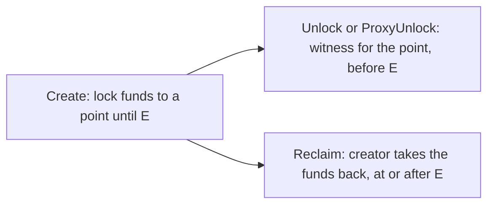

# zenon-ptlc

Point time-locked contracts for the Network of Momentum, taken to mainnet readiness:
the embedded contract on go-zenon's release line with its tests, a `znn-cli` reference
client in Dart, and three runnable swaps that demonstrate it: NoM-to-NoM on point locks,
NoM-to-NoM on key locks with no secret on the chain, and NoM-to-BTC.
The goal is Bitcoin interoperability by scriptless scripts, which is what Mr Kaine asked
for in 2022 and what the official Phase 1 scope lists under Accessibility
([REFERENCES.md](REFERENCES.md)).

**Started 2026-10-08 (UTC).** The lineage is George's go-zenon PR #13 (2023), hardened
by 0x3639 in 2026-05 (`codex/ptlc-testnet-local`), ported here onto `release/0.0.9`
and merged with zenon-zbtc's scalar point lock ([DECISIONS.md](DECISIONS.md) D-01 to
D-05).

To run all of it: `docker compose up -d --build` in this directory, then open
http://localhost:8470 ([Launching the lab console](#launching-the-lab-console)).
That is the devnet with the contract active, regtest bitcoind, and the
[lab console](lab/README.md). Beside the console is a
[scenarios page](lab/README.md#the-scenarios-page), http://localhost:8470/scenarios/:
twenty-one scenarios, one button each, every step signed by the back end and drawn as it
happens, in plain words. The same lab is published at https://ptlc.zenon.foo, with the
node's RPC at `/rpc` and `wss://ptlc.zenon.foo`. The gateway and the tunnel that publish
it are not in this branch.

## In this branch

This directory is the `zenon-ptlc` project, placed in go-zenon's `ptlc-dev` branch
beside the contract it tests. It was written as a repository of its own, next to
worktrees of go-zenon and the two Dart repositories, and the files below still read that
way: a path such as `C:\dev\zenon\go-zenon-ptlc` or a tree hash of `ptlc/release-0.0.9`
is the history of how the lab was built, not what it builds from here. Three things
differ:

- **The node is built from this branch.** `compose.yml` hands the go-zenon tree one
  level up to the build, so the devnet runs the contract that is checked out, and the
  scenarios compile against it (`scenarios/nom-to-btc/go.mod` replaces go-zenon with
  `../../..`). [`patches/`](patches/) and [`patches-dev/`](patches-dev/) are kept as
  the same contract on `release/0.0.9` and on `dev`;
  `-f docker/compose.release.yml` builds the lab from the first of them.
- **The Dart SDK and CLI are still patched.** They are fetched from upstream at pinned
  commits and patched from [`dart/`](dart/), and the build fails unless each patched
  tree has the hash of the branch it was exported from.
- **Nothing here publishes the lab.** The Caddy gateway, the Cloudflare tunnel and the
  handoff notes that describe them are left out. `labd` answers to `localhost` and
  `127.0.0.1` only, unless `PTLC_PUBLIC_URL` names another address
  ([lab/README.md](lab/README.md)).

The branch's own devnet (`docker/devnet`, `make devnet-up` at the root) and this one
are separate: different container names, a different subnet and different volumes, so
both can be up. They publish the same host ports, 35991, 35997 and 35998, so one of them
has to move (`ZNND_DEVNET_PILLAR_HTTP`, `ZNND_DEVNET_RPC_HTTP` and `ZNND_DEVNET_RPC_WS`
move the root one).

## Launching the lab console

Docker with Compose v2.24 or later is all that is needed; nothing is installed on the
host. From the root of the repository:

```sh
cd ptlc-lab
docker compose up -d --build
```

The first build takes several minutes: it compiles the node, the Dart CLI, the three
scenario programs and the page, and runs their tests on the way. An image whose tests
fail is not built. Then:

| Address | What is there |
|---|---|
| http://localhost:8470 | The console: each of the contract's four calls, signed in the page with a devnet key or by the Syrius extension, with the contract's chain beside it |
| http://localhost:8470/scenarios/ | Twenty-one scenarios, one button each |
| http://localhost:35997, ws://localhost:35998 | The node's RPC, chain id 69 |

The devnet needs about two minutes after a first start before its momentums come every
ten seconds; the scenarios page says "Chain live" with the height once they do.

```sh
docker compose run --rm cli ptlc.keygen       # znn-cli with the ptlc.* commands
docker compose run --rm keyswap               # the swap on key locks, both parties
docker compose run --rm nom-to-btc            # regtest bitcoin for devnet ZNN
docker compose run --rm test-go               # the contract's unit and mock-chain tests
docker compose run --rm test-live             # the branch's live suite, against this devnet
docker compose run --rm test-scenario         # the scenario programs' tests
docker compose run --rm test-dart             # the SDK's tests, BIP-340 vectors included

docker compose down                           # stop; the chain is kept
docker compose down -v                        # wipe; the next up starts from genesis
```

To walk the pages the way a person would, in a headless Chrome on the host (Node 20 or
later, and Chrome):

```sh
node lab/e2e/scenarios.mjs                    # all twenty-one scenarios, about 40 minutes
node lab/e2e/scenarios.mjs --only secret,swap # some of them
node lab/e2e/benches.mjs                      # the console's four benches, about ten minutes
```

The keys the lab signs with are the devnet's, which are public, and `labd` runs programs
for whoever can reach the page. It is published on loopback only. Do not put it on an
address others can reach without reading [REVIEW.md](REVIEW.md) first.

| File | What it tracks |
|---|---|
| [SPEC.md](SPEC.md) | The contract: ABI, point types, unlock message, lifecycle; the three swap protocols as sequence diagrams |
| [DECISIONS.md](DECISIONS.md) | Every choice, the alternative rejected, and why |
| [ASSUMPTIONS.md](ASSUMPTIONS.md) | What is relied on without proof here, and how to check it |
| [GAPS.md](GAPS.md) | What this repository does not do |
| [TODO.md](TODO.md) | Ordered work, open and done |
| [REFERENCES.md](REFERENCES.md) | Canonical sources, prior code, standards |

## What a PTLC is here

An `htlc` entry pays whoever shows the preimage of a hash. A `ptlc` entry pays whoever
shows the secret behind a **point** on an elliptic curve. There are three ways to show
it, and the contract accepts all three as point types:

| `pointType` | Lock | Witness | Shown on chain |
|---|---|---|---|
| 0 Ed25519 | a 32-byte Ed25519 public key | a 64-byte signature over the unlock message | the signature |
| 1 BIP-340 | a 32-byte x-only secp256k1 key | a 64-byte Schnorr signature over the unlock message | the signature |
| 2 secp256k1 point | a 33-byte compressed point `T` | the 32-byte scalar `t` with `t·G = T` | `T` and `t` |

Types 0 and 1 are George's design: the secret never touches the chain, and a swap moves
it between chains inside an adaptor signature. Type 2 is Lightning's design: the claim
publishes the scalar, and the other chain's adaptor signature is completed from it.
Both are unlinkable to Bitcoin, where only an ordinary Schnorr signature ever appears.



## Layout

| Path | What it is |
|---|---|
| `C:\dev\zenon\go-zenon-ptlc` | Worktree of go-zenon, branch `ptlc/release-0.0.9`: the contract, its tests, 0x3639's docs and live suite |
| [`patches/`](patches/) | The branch as patches against `release/0.0.9` at `a681890`, so the work is reproducible without the worktree |
| `C:\dev\zenon\go-zenon-ptlc-dev`, [`patches-dev/`](patches-dev/) | The same contract on `dev` at `ea62f35`, branch `ptlc/dev`, wired as its own spork bit (D-17) |
| `C:\dev\zenon\znn_sdk_dart-ptlc`, `C:\dev\zenon\znn_cli_dart-ptlc` | Worktrees of the Dart SDK and CLI, branch `ptlc` each: ABI, model, RPC, BIP-340 and secp256k1 helpers; the `ptlc.*` commands |
| [`dart/`](dart/) | Patches of both Dart branches |
| [`devnet/`](devnet/) | A one-pillar devnet built from the worktree with the PTLC spork active from genesis |
| [`scenarios/nom-to-nom/`](scenarios/nom-to-nom/) | Two scalar locks with a tweak: an unlinkable ZNN-for-QSR swap between two devnet accounts, driven by the CLI |
| [`scenarios/nom-to-btc/`](scenarios/nom-to-btc/) | Regtest bitcoin for devnet ZNN: Taproot output, adaptor pre-signature, scalar lock on NoM, claim completed from the revealed scalar; the refund path |
| [`compose.yml`](compose.yml), [`docker/`](docker/) | The whole lab as containers. The node is built from the go-zenon tree this directory sits in; the Dart images from upstream commits and the patches here, and a build fails unless each patched tree is its branch's tree, hash for hash |
| [`lab/`](lab/README.md) | The lab console: a page that makes every contract call itself, through a devnet key or the Syrius extension (v0.3.4 and later), and a small back end that runs `znn-cli` and the scenarios for it. The scenarios page, which runs each scenario at a button and signs nothing itself. Their tests, three end-to-end scripts, and a checker that renders every diagram in these files |
| [`scenarios/nom-to-btc/keyswap`](scenarios/nom-to-btc/keyswap/), [`cmd/keyswap`](scenarios/nom-to-btc/cmd/keyswap/) | The swap on key locks ([SPEC.md §5](SPEC.md#5-nom-to-nom-swap-on-key-locks-no-secret-on-the-chain)): one party's client, which saves each stage before acting on it and carries on from its file after a stop, its tests on go-zenon's mock chain, and the program that runs both parties on the devnet |
| [`scenarios/nom-to-btc/cmd/flows`](scenarios/nom-to-btc/cmd/flows) | The scenarios page's back end: twenty-one scenarios over every call and lock type, and four mistakes the contract cannot stop, signed with the devnet's keys, each step checked against what the contract must do |
| [`REVIEW.md`](REVIEW.md) | The adversarial review of 2026-10-09: fourteen findings, what was fixed and where, and the one left for the owner |
| [`test/vectors/`](test/vectors/) | The official BIP-340 vectors and this repo's own known-answer vectors, shared by the Go and Dart tests |

## Status, 2026-10-08 (UTC)

| Piece | State |
|---|---|
| Contract on `release/0.0.9` | Built. 0x3639's nine commits plus four of this repo's: `bb0bb23` the point type and the destination, `430fb6d` docs, and since the review of 2026-10-09 `97c0061`, two tests of the swap order and two sections of the security notes, and `38083f5`, the note that an Ed25519 lock is not decoded and the check is the client's ([D-34](DECISIONS.md)). The last two change no contract code. The PTLC packages' tests pass, 37 mock-chain tests among them before the review's two; go-zenon's whole suite passes except three tests that fail identically on pristine `a681890` on this host ([ASSUMPTIONS A-10](ASSUMPTIONS.md)) |
| Live RPC suite of the branch | 6 of 6 pass against the devnet wrapper (04:05 to 04:30 UTC), including 0x3639's two-party swap choreography and its abort path |
| Dart SDK and CLI branches | Built. BIP-340 official vectors pass; adaptor signatures agree with the Go side on 16 shared vectors; the unlock message matches go-zenon on 24 known answers; the CLI compiles against SDK 1.0.0 |
| NoM-to-BTC swap | **Both paths ran** on the devnet and regtest (2026-10-08 03:45 to 04:00 UTC). Happy: Bob read `t` off the contract's chain 30 s after Alice's unlock and claimed 99,500 sats; Alice received the ZNN. Refund: Alice never revealed, took her bitcoin back by the CLTV leaf at height 134, and Bob reclaimed his ZNN 50 s after the NoM expiry |
| NoM-to-NoM swap | **In the safe order since 2026-10-09** ([D-30](DECISIONS.md)): Alice, who holds `t`, locks first and expires last. The 2026-10-08 run (`scenarios/nom-to-nom/run.sh`, 03:51 to 03:54 UTC) was in the unsafe order, Bob first and last, as were the spec, the mock-chain test and the lab's two walks; all are corrected, with mock-chain tests of the old order losing and of a late claim ([REVIEW.md](REVIEW.md) R-01) |

| NoM-to-NoM swap on key locks | **Built and run 2026-10-09** ([SPEC.md §5](SPEC.md#5-nom-to-nom-swap-on-key-locks-no-secret-on-the-chain), [D-35](DECISIONS.md)): two BIP340 key locks, each payable only to the other party, and a single-signer adaptor pre-signature each way; neither the secret nor its point is on the chain, and no key is held by two parties. No contract change. Six mock-chain tests in go-zenon (`0777966`); a client that saves each stage before acting on it, with seventeen tests on the mock chain, a restart at every stage and a stop between publishing a block and saving it among them; on the devnet the swap ran in 1 min 42 s (18:30 UTC) and again stopped with both locked and carried on from disk (18:32 to 18:33). Not built: a transport between two machines, a wallet in place of the client's account key, a Dart client ([GAPS G-05, G-19, G-20](GAPS.md)) |
| Containers and lab console | **Built and run** 2026-10-08. `docker compose up -d --build` gives the devnet, bitcoind and the console; `test-go`, `test-scenario` and `test-dart` pass in containers; the NoM-to-BTC swap ran through the console in 68 s. The page's encoder and curve code agree with the Go and Dart ones on the shared vectors, byte for byte |
| Syrius extension | **All four calls made through it**, v0.3.4 and v0.4.0, by [`lab/e2e/syrius.mjs`](lab/e2e/syrius.mjs): `Create`, `Unlock`, `ProxyUnlock`, a `Reclaim` refused before expiry and accepted after. The wallet shows the contract as "unrecognized" and signs ([GAPS G-10](GAPS.md)); its own key cannot be an Ed25519 lock ([G-09](GAPS.md)). Rerun 2026-10-08 15:50 to 16:06 UTC: 21 of 21 and 24 of 24, the second with the wallet dialling the node through the public gateway's WebSocket route |
| Review | **Adversarial review on 2026-10-09** ([REVIEW.md](REVIEW.md)): fourteen findings, one critical (the NoM-to-NoM swap's order) and three high, fixed in the lab, the CLI, both swap programs and go-zenon's tests. The one in the contract, Ed25519 locks of small order, the owner decided to leave as it is, as Go's `crypto/ed25519` and Zcash's ZIP-215 do; the clients refuse such keys ([D-34](DECISIONS.md), [G-17](GAPS.md)). On the image that carries that decision, both walks passed whole through Cloudflare on 2026-10-09: the nineteen scenarios, 60 of 60 checks, and the benches, 24 of 24 (HANDOFF.md) |
| Scenarios page | **Twenty-one scenarios since 2026-10-09 18:43 UTC: 21 of 21 passed, 66 of 66 checks**, through Cloudflare on the image now live (`951a9fb04101`), 18:48 to 19:22 UTC ([transcript](lab/e2e/runs/2026-10-09-keyswap-scenarios-public.txt)); the two added are the key swap and its mistake. Earlier that day, nineteen: 19 of 19 passed, 60 of 60 checks, through Cloudflare on the image then live (`fbdd331c5393`), 16:49 to 17:19 UTC ([transcript](lab/e2e/runs/2026-10-09-review-scenarios-public-3.txt)). On the two images before it that day, 18 of 19 and the first ten of ten, each stopped for a reason [REVIEW.md](REVIEW.md) gives. Before that, **fourteen scenarios, 14 of 14 passed** (2026-10-08 16:33 to 16:55 UTC), each started by a button and signed by the back end: the three lock types, a relayed unlock, five refusals, the deadline rules, the NoM-to-NoM swap and its abandonment, the Bitcoin swap and its refund. Every payout was read off the contract's own send. Walked by [`lab/e2e/scenarios.mjs`](lab/e2e/scenarios.mjs) through the public gateway's routes ([lab/README.md](lab/README.md#the-scenarios-page)) |
| Public address | **Live since 2026-10-08 17:07 UTC**: https://ptlc.zenon.foo (console), https://ptlc.zenon.foo/scenarios/, the node at `https://ptlc.zenon.foo/rpc` and `wss://ptlc.zenon.foo`. Through Cloudflare: all twenty-one scenarios walked on the page (66 of 66 checks, 2026-10-09 18:48 to 19:22 UTC), the console's bench walk whole (24 of 24, 17:19 to 17:30), and the node's WebSocket and HTTP RPC called from a browser on the page. Not yet through it: a wallet extension ([TODO T-23](TODO.md)). No rate limit yet ([T-22](TODO.md), gateway/README.md) |
| Look | **Both pages on the Zenon design system since 2026-10-09**, dark by default with a light theme, plain background. Rechecked on it: three scenarios through Cloudflare (12 of 12 checks), two more after the background was removed (9 of 9), the bench walk without its refund path (18 of 18); and later that day, after the review, every scenario and the whole bench walk (the rows above). Not rerun on it: the Syrius scripts ([lab/README.md](lab/README.md#how-it-looks), [DECISIONS D-29](DECISIONS.md)) |

Nothing here has been proposed upstream yet ([GAPS.md](GAPS.md) G-02). The ordered list of what is left is [TODO.md](TODO.md).
