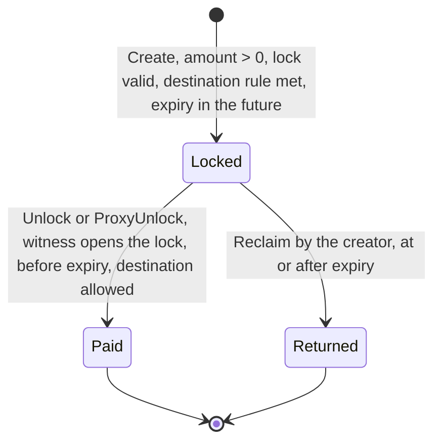
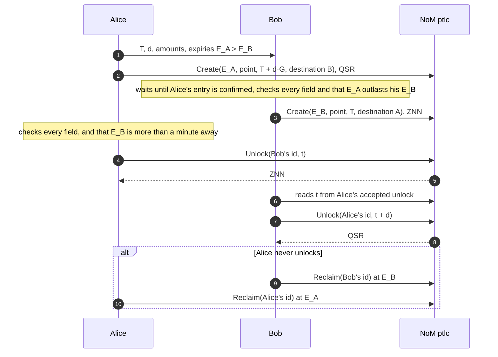
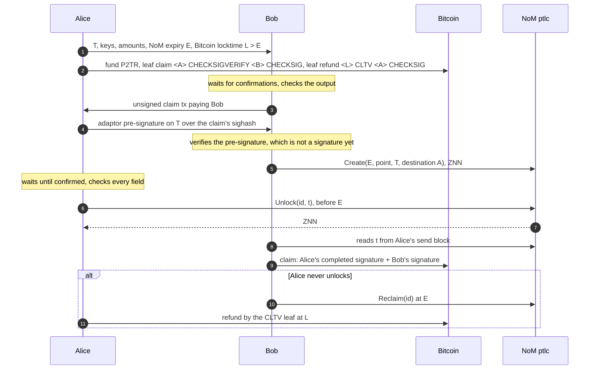
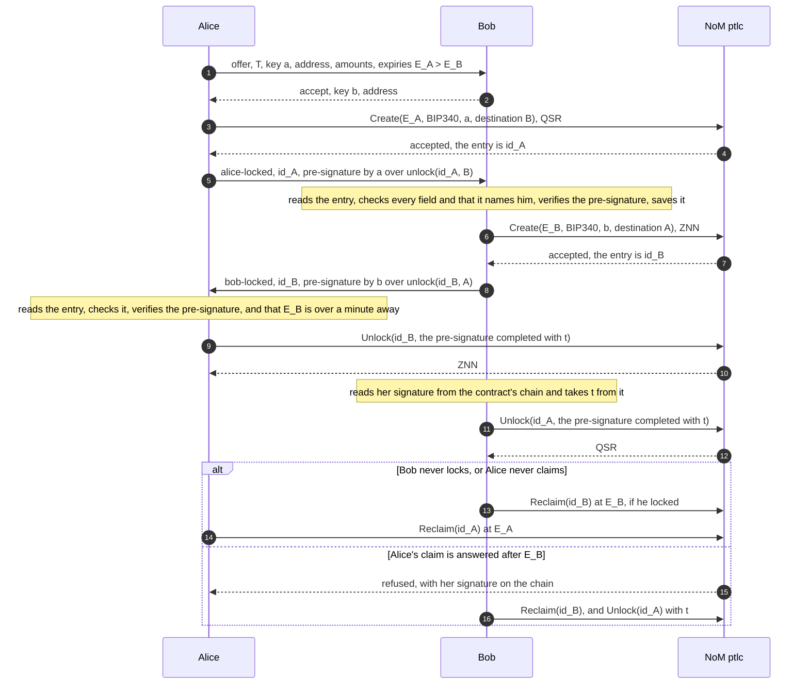

# The PTLC contract and the three swaps

**Written 2026-10-08 (UTC)** against go-zenon branch `ptlc/release-0.0.9` in
`C:\dev\zenon\go-zenon-ptlc`, source files `vm/embedded/definition/ptlc.go` and
`vm/embedded/implementation/ptlc.go`. Every statement here is checked by a test named
in the text. **Corrected 2026-10-09** after the review in [REVIEW.md](REVIEW.md): §3's
swap ran in an order that is unsafe for the party without the secret, §1.2 overstated
what the contract checks of an Ed25519 lock, and §1.5 did not say that a refused unlock
still publishes its witness. **Added to later that day:** §5, a swap on key locks that
needs no key held by two parties, and with it a correction to §2, which said such a
swap needed one.

Back to the [README](README.md). Decisions behind this design: [DECISIONS.md](DECISIONS.md).

---

## 1. The contract

Address `z1qxemdeddedxptlcxxxxxxxxxxxxxxxxx6lqady`, spork id
`e59f1e97f1096a18c2bc8421345b2633b11b839adb153e96dc65034c95f83f8d` (exists on mainnet
since 2023, never activated), RPC namespace `embedded.ptlc`.

### 1.1 ABI

| Method | Arguments | Sends | Does |
|---|---|---|---|
| `Create` | `expirationTime int64`, `pointType uint8`, `pointLock bytes`, `destination address` | the funds to lock, any ZTS, amount > 0 | Stores an entry whose id is the hash of this send block |
| `Unlock` | `id hash`, `signature bytes` | nothing | Pays the entry to the caller if the witness opens the lock, before `expirationTime` |
| `ProxyUnlock` | `id hash`, `destination address`, `signature bytes` | nothing | The same, paid to `destination`, submitted by anyone |
| `Reclaim` | `id hash` | nothing | Returns the entry to its creator at or after `expirationTime` |

The `signature` argument carries the **witness**: a signature for the key types, the
scalar for the point type. The name is PR #13's and is kept so that its ABI id does not
change for the two unlock methods.

Method ids: `Create` `22cec8ee`, `Unlock` `d33791d3`, `ProxyUnlock` `8bffc216`,
`Reclaim` `7e003c8d` (`vm/embedded/embedded_test.go`).

### 1.2 Point types

| `pointType` | Lock (`pointLock`) | Witness | Checked by |
|---|---|---|---|
| 0 `ED25519` | 32-byte Ed25519 public key; **the length is all the contract checks** (G-17) | 64-byte Ed25519 signature over the unlock message | `wallet.VerifySignature` |
| 1 `BIP340` | 32-byte x-only secp256k1 key, must parse (`schnorr.ParsePubKey`) | 64-byte BIP-340 signature over the unlock message | `btcec/v2/schnorr` |
| 2 `Secp256k1Point` | 33-byte compressed point `T`, prefix `0x02` or `0x03`, must be on the curve | 32-byte scalar `t`, canonical (nonzero, below the group order), with `t·G = T` | `btcec.ScalarBaseMultNonConst` |

A secp256k1 lock that fails these checks is refused at `Create` with
`ErrInvalidPointLock`, so an entry of those two types that can never be opened is never
made (`TestPtlc_pointLock_create_rules`, `TestPtlc_createRejectsInvalidBIP340Point`).

An Ed25519 lock is not decoded at `Create`. Thirty-two bytes that are no point make an
entry no signature opens; a point of small order makes one that a signature anybody
can write down opens, because Go's `crypto/ed25519` accepts such a key. With the
identity as the key (`01` and 31 zero bytes), the signature `01 00…00 ‖ 00…00`
verifies for every message: the scenarios page's `weak-key` does exactly that on the
devnet, and Carol is paid. The console and the CLI refuse both kinds of key before
sending. The contract does not, by the owner's decision ([DECISIONS.md](DECISIONS.md)
D-34, which compares what other systems do): a client that makes or trusts a type-0
lock checks the key itself ([GAPS.md](GAPS.md) G-17).

### 1.3 Destination

`destination` is the only address an unlock may pay. The zero address means "any
address the witness binds", and is allowed for the key types only.

- A point lock **must** name a destination (`ErrInvalidDestination` otherwise). Its
  witness is a bare scalar: anyone who reads it from the claim's send block, which is
  public one momentum before the contract acts on it, could otherwise submit a
  `ProxyUnlock` to themselves first.
- A key lock may name one. Then a signature over another destination is refused with
  `ErrPermissionDenied` even though it verifies (`TestPtlc_fixedDestination_keyLock`).
- An embedded contract is never a valid fixed destination: the payout is a contract
  send with no data, which no embedded contract accepts. Such an entry would lose
  nothing (the VM rolls back an unlock whose payout it cannot deliver, entry
  included) but it could never be opened, only reclaimed at expiry. The check is
  against the list of embedded contracts; an address of the contract type (first byte
  1) that is not on the list passes it and is just as unpayable. The console and the
  CLI refuse both by the type byte.

For a point lock, `ProxyUnlock` from a third party to the fixed destination is
accepted: who submits does not matter, where it pays does
(`TestPtlc_pointLock_unlock`).

### 1.4 The unlock message

What a key-type witness signs, 101 bytes hashed with SHA3-256:

| Offset | Size | Field |
|---:|---:|---|
| 0 | 20 | `zenon-ptlc-unlock:v1` (ASCII) |
| 20 | 8 | chain identifier, unsigned 64-bit big-endian, from the frontier momentum |
| 28 | 20 | the contract address, raw bytes |
| 48 | 1 | `pointType` |
| 49 | 32 | the entry id |
| 81 | 20 | the destination, raw bytes |

The chain binding stops a signature made for one Zenon network verifying on another;
the contract and id binding stop it moving between entries; the destination binding
is what makes `ProxyUnlock` safe (`TestPtlc_VerifySignatureRejectsWrongDomainFields`,
`TestPtlc_WitnessIsDestinationBound`, `TestPtlc_WitnessNotPortableAcrossEntries`).
The point type signs nothing; its binding is the fixed destination.

### 1.5 Lifecycle



- The entry is deleted before the payout block is built, so a second unlock in the
  same momentum finds nothing (`TestPtlc_DoubleUnlockDeletesBeforeSecondWithdrawal`).
- A refused unlock leaves the entry and moves nothing, but its witness is public: the
  caller's send block, data and all, is on the chain before the contract answers it.
  An unlock answered at or after the expiry is refused and gives the secret away all
  the same (G-18). Every client here refuses to send one with under 60 seconds left by
  the chain's clock (D-31).
- `Unlock` at `momentum.Timestamp >= expirationTime` is `ErrExpired`; `Reclaim` before
  it is `ReclaimNotDue`. Expiry is judged by the frontier momentum's timestamp, not the
  caller's clock.
- Stored state is re-validated before an unlock pays; a corrupt entry fails closed
  (`TestPtlc_UnlockRejectsCorruptStoredPointType`). Reclaim validates only what a
  refund needs, so a corrupt lock cannot trap funds (`TestPtlc_ReclaimIndependentOfPointFields`).
- Plasma: `Create` costs `EmbeddedSimple`; the three others `EmbeddedWWithdraw`.

### 1.6 RPC

`embedded.ptlc.getById(id)` returns the entry with `amount` as a decimal string, like
`embedded.htlc.getById`:

```json
{"id":"…","timeLocked":"z1…","tokenStandard":"zts1…","amount":"1000000000",
 "expirationTime":1000000300,"pointType":2,"pointLock":"<base64>","destination":"z1…"}
```

### 1.7 Errors

| Error | When |
|---|---|
| `invalid point type` | `pointType` not 0, 1 or 2 |
| `invalid point lock` | wrong size, unparseable key, point not on the curve or not compressed |
| `invalid destination` | point lock with the zero destination; any fixed destination that is an embedded contract |
| `invalid signature` | key-type witness of the wrong size or failing verification |
| `invalid scalar` | point-type witness of the wrong size, zero, at or above the order, or not the lock's discrete log |
| `address cannot call this method` | unlock to an address that is not the fixed destination; reclaim by anyone but the creator |
| `expired`, `entry is not expired`, `data non existent` | as named |

## 2. Why three point types

The key types are George's 2023 design: the secret never touches the chain, and a swap
moves it between chains inside an adaptor signature. Mr Kaine's reason for wanting
PTLCs, "fungibility and less block space", is met in full: the chain shows a signature
by a key that looks random. The cost is an exchange between the parties: each has to
hold the other's adaptor pre-signature before the secret is used. With a fixed
destination on each entry (§1.3) a key of one party is enough and the exchange is two
messages (§5). A key lock that names no destination needs a key held by both, as a
Bitcoin key path does (MuSig2), and this repository does not build that.

The point type is Lightning's design ("pay whoever reveals the scalar behind `T`"),
offered directly because this VM can multiply a point and Bitcoin script cannot. The
NoM leg needs nothing exchanged but the point: the claim publishes `t`, the
counterparty reads it. NoM shows `T` and `t`; Bitcoin still shows one ordinary signature; nothing links
them. zenon-zbtc ran the BTC⇄ZNN swap on exactly this lock, 35 of 35 runs.

Both are PTLCs in the sense the literature uses. The repo ships both so that a client
can pick the private one when it can exchange pre-signatures with its counterparty
and keep them, and the simple one when it cannot.

## 3. NoM-to-NoM swap on point locks with a tweak

Alice has QSR and wants ZNN; Bob the reverse. Alice holds the secret `t`. The two
agree a tweak `d` off chain. Alice's lock is to `T' = T + d·G`, Bob's to `T = t·G`. On
chain the two points are unrelated.



The party holding the secret locks first and its entry expires last (D-30). Bob locks
only once Alice's entry is on the chain and checked, with `E_B` earlier than `E_A` by at
least his time to claim. Alice can take the ZNN only by showing `t`, only before
`E_B`, and whenever she does Alice's own entry is open to Bob for at least `E_A - E_B`
more. If she never shows it, Bob reclaims at `E_B` and she at `E_A`.

Until 2026-10-09 this section had the order the other way round, Bob first and Bob
last, which is unsafe for Bob: Alice can claim his entry and never fund hers, or let
hers expire, reclaim it, and claim his afterwards, which is still open. Bob then learns
`t` with nothing left to open. The contract cannot tell the orders apart, since every
call is valid in both. The go-zenon tests `TestPtlc_pointLock_tweakedSwap` (the safe
order), `TestPtlc_pointLock_swapOrder_wrongOrderLosesBob` and
`TestPtlc_pointLock_swapOrder_lateRevealCostsTheRevealer` run the three cases on the
mock chain; the devnet scenario in [`scenarios/nom-to-nom`](scenarios/nom-to-nom/)
runs the swap with the CLI, and the scenarios page runs all three (`swap`,
`wrong-order`, `late-reveal`).

Two rules for the clients, both from the review of 2026-10-09 ([REVIEW.md](REVIEW.md)):
Alice does not send her unlock with under 60 seconds left before `E_B` (an unlock
answered after it is refused and still shows `t`, D-31), and Bob takes `t` only from
an unlock the contract accepted, checked against `T` (anyone can send a refused one
with a junk witness first).

## 4. NoM-to-BTC swap: a point lock on NoM, an adaptor signature on Bitcoin

Alice has BTC and wants ZNN; Bob has ZNN and wants BTC. Alice holds `t`.



The pre-signature is useless on its own: Bob can complete it only with `t`, and `t`
appears only when Alice takes the ZNN. Alice's refund leaf needs no one's cooperation.
Here too the holder of the secret locks first and her lock lasts longer: the bitcoin
is locked until `L`, the ZNN only until `E`.

The timelocks must satisfy `L > E` plus the time Bob needs to see `t` and get a
Bitcoin transaction confirmed. If the refund could open while Bob's entry is still
open, Alice would take the bitcoin back by her leaf and the ZNN with `t`. Bob checks
this before he answers the terms (D-32): at a block every 300 s, twice Bitcoin's rate
because faster blocks are what hurt him, `L` must come at least three blocks after `E`.
Terms that fail are refused before anything is locked (`-scenario bad-terms`, and the
page's `swap-btc-bad-terms`). Bob also waits for Alice's funding to confirm before he
locks; one confirmation on regtest, where only the program mines, and six on a real
chain, where a reorganisation that takes the funding away would leave his ZNN open to
`t` with nothing on Bitcoin for him (`-confirmations`).

The adaptor construction is BIP-340's with a nonce offset: `R = k·G + T`,
`s' = k + e·d_A`, and the completed signature is `s = s' + t` when `R` has even y,
`s' - t` otherwise; Bob extracts `t = ±(s - s')` by the same parity. The Dart SDK's
`Bip340.adaptorSign`/`adaptorComplete`/`adaptorExtract` and the scenario's Go code
implement it and are tested in all four key and nonce parity cases.

A MuSig2 key-path output is the production shape ([GAPS.md](GAPS.md) G-03); the
script path is used here so that the demo is one Go module with no signer daemon.

## 5. NoM-to-NoM swap on key locks: no secret on the chain

The swap of §3 with nothing of the secret on the chain. Alice has QSR and wants ZNN;
Bob the reverse. Alice holds `t`, and both know `T = t·G`. Each locks to a BIP340 key
of its own, made for this swap, and names the other as the entry's destination. Each
gives the other an adaptor pre-signature on `T` over its own entry's unlock message
(§1.4): a signature by the lock's key with `t` left out.



The chain shows two entries locked to two keys nobody has seen before, and one
ordinary signature by each. `T` is in no entry and `t` in no call; the tweaked swap of
§3 hides that its two points are related, and shows both points and both scalars.

**Why one key is enough here.** On Bitcoin this swap needs a key held by both parties
(MuSig2), because an output cannot say who it pays: whoever can sign can send the
coins anywhere. A NoM entry can (§1.3). With the counterparty as its fixed destination,
the lock's key is good for one thing, paying the counterparty, and its owner signing
early only hurts its owner. §2 said until 2026-10-09 that the key types need a
two-party signing session on the NoM leg; that was true of PR #13's contract, which
had no destination field, and stopped being true with D-05. An entry that names nobody
undoes it: Alice signs her own entry back to herself and claims Bob's as well
(`TestPtlc_keySwap_openDestinationLosesBob`, and `swap-key-open` on the page). The
contract accepts such an entry, so the check is Bob's.

**What crosses between the parties.** Four messages, each JSON
([`keyswap/protocol.go`](scenarios/nom-to-btc/keyswap/protocol.go)):

| Message | From | Carries |
|---|---|---|
| `offer` | Alice | `T`, her key, her address, both amounts and tokens, `E_A` and `E_B` |
| `accept` | Bob | his key, his address |
| `alice-locked` | Alice | `id_A` and her pre-signature |
| `bob-locked` | Bob | `id_B` and his pre-signature |

A pre-signature can only be made once its entry exists, because the unlock message
contains the entry's id and the id is the hash of the `Create` block. Nothing is
signed before funding, and nothing needs to be: the way back is the contract's
`Reclaim`, not a transaction the other side has to have signed.

**What each party checks**, and what it does when a check fails:

| Who, when | Checks | If not |
|---|---|---|
| Bob, on the offer | `T` is a point and Alice's key a key; the amounts are the trade he came for; `E_A - E_B` is at least his time to claim; `E_B` is far enough off for two locks and a claim | he does not answer; nothing is locked |
| Alice, before she locks | Bob's key is a key, his address an account; `E_B` is still far enough off | she does not lock |
| Bob, before he locks | Alice's entry is on the chain with her key, **his address as destination**, the amount, the token and `E_A`; her pre-signature verifies for that entry, his address and `T`; `E_B` is still far enough off | he does not lock; Alice reclaims at `E_A` |
| Alice, before she claims | Bob's entry likewise, and his pre-signature; at least 60 s left before `E_B` | she keeps `t`, and both reclaim |
| Bob, reading the chain | the scalar taken from a signature is the one behind `T` | he ignores that call |

Bob reads every unlock of his entry the contract has answered, refused ones included.
A refused one is exactly the late claim that gives him `t`, and a junk one yields a
scalar that is not behind `T`. This differs from §3's rule only in appearance: there a
witness is the scalar and is checked against `T`, here it is checked after the
subtraction.

**Order and time** are §3's. The holder of the secret locks first and expires last
(D-30); she does not claim with under 60 s left before `E_B` (D-31), because a claim
answered late is refused with the completed signature on the chain, and that signature
gives Bob `t` as surely as a bare scalar would (G-18). The client's figures are in
`keyswap.Policy`: a call is allowed 45 s to be answered, so `E_A - E_B` is at least
90 s, Bob locks only with 105 s left on `E_B`, and Alice with 150 s. They suit the
lab's devnet and nothing else.

**What a party must keep.** Three things cost funds if lost at the wrong moment, and
the client writes each to disk before the step that depends on it
([`keyswap/store.go`](scenarios/nom-to-btc/keyswap/store.go)):

| What | Whose | Needed until | If lost |
|---|---|---|---|
| the swap key | each party's own | its entry is settled | it cannot pre-sign; the swap stops and both reclaim |
| `t` | Alice's | she has claimed | she cannot claim; both reclaim |
| the other side's pre-signature | Bob's above all | he has claimed | after Alice's claim he knows `t` and still cannot make the signature that pays him; Alice reclaims at `E_A` and has both |

A party's state is one file, written beside the old one, flushed, and renamed over it.
The stage is saved before the party acts on it, so a party that stops at any point
carries on from its file. A block published and not yet written down is found again
rather than sent twice: a `Create` by its lock key on the party's own account chain,
an unlock on the contract's. A party sends its last message again whenever it
starts, so the link between the two may lose what was in flight.

**Nonces.** A pre-signature's nonce is derived from the key, the message, `T` and
fresh randomness (`adaptor.Sign`). Signing again never puts one nonce against two
challenges, so no journal of used nonces is needed, unlike a MuSig2 session, where the
challenge depends on the other party's nonce. The client still keeps the one
pre-signature it sent and sends that one again.

**Where it runs.**

| What | Where | Covers |
|---|---|---|
| the contract | `vm/embedded/tests/ptlc_keyswap_test.go` in go-zenon (patch 0014) | the swap in the four parity cases of key and nonce; the pre-signature and each key opening nothing else; Bob never locking; Alice never claiming; the late claim; the entry that names nobody |
| the client | [`keyswap/keyswap_test.go`](scenarios/nom-to-btc/keyswap/keyswap_test.go): both parties on go-zenon's mock chain, through the node's RPC served in process | the swap; a restart at each of sixteen stages; a stop between publishing and saving; the link losing everything; both abandon paths; the late claim; a bad pre-signature either way; the entry that names nobody; every check in the tables above |
| the devnet | `cmd/keyswap`, both parties in one process ([README](scenarios/nom-to-btc/README.md#the-key-swap)) | the swap, and the swap stopped with both locked and carried on from disk |
| the page | `swap-key` and `swap-key-open` | each call answered by the contract, the payouts, and the secret absent from every unlock |

**Not built.** A transport between two machines and a wallet in place of the
client's account key ([GAPS.md](GAPS.md) G-05, G-19); a Dart client (G-20). The
state file holds the swap key and `t` in the clear, and a directory restored from an
older copy forgets what was sent since (G-21).
