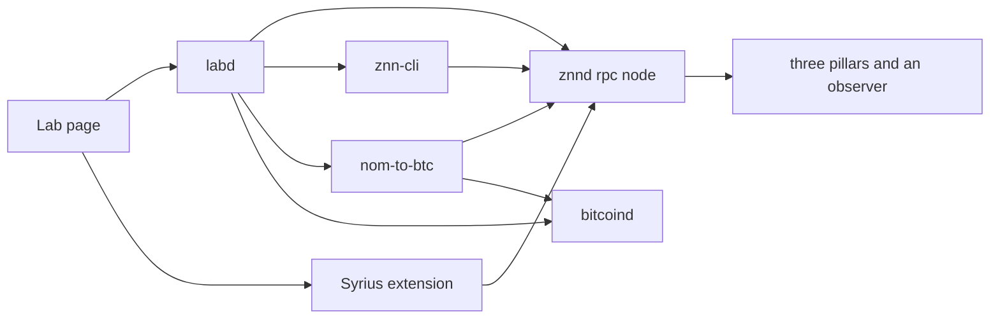
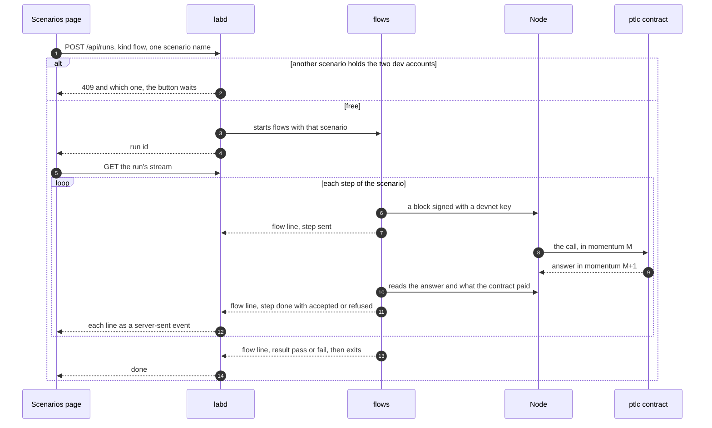
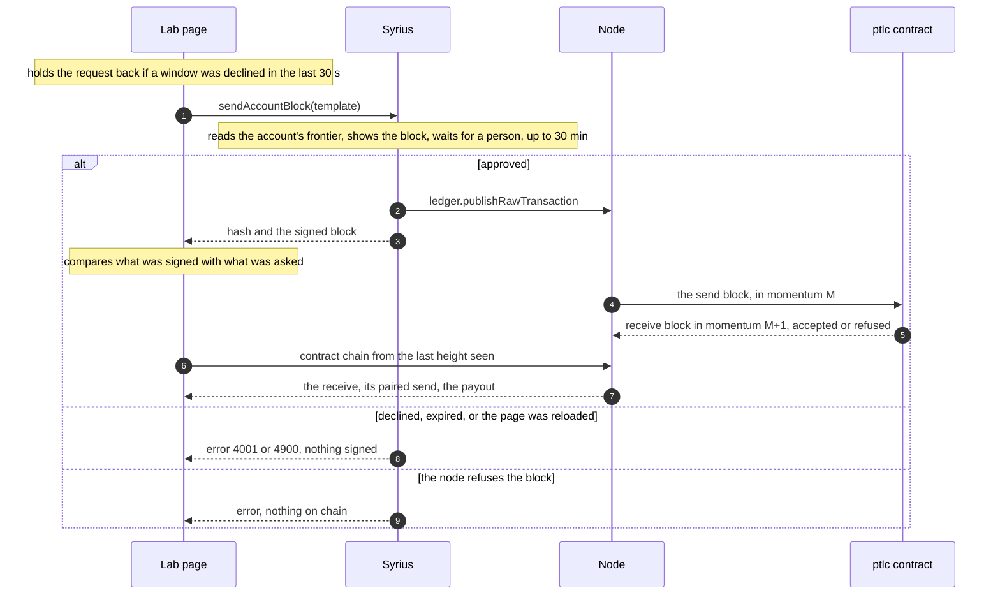

# The PTLC lab

A console for the ptlc contract on a devnet: every one of its four calls, through every
client that exists for it, with the contract's own chain beside each of them. It is for
testing. The keys it signs with are the devnet's public ones and it will run programs on
request, so on the machine it listens on loopback only. It is also published, whole, at
**https://ptlc.zenon.foo**, through a gateway and a tunnel that are not part of this
branch.

Back to the [README](../README.md). The contract itself is [SPEC.md](../SPEC.md).

## Run

From the repository root:

```sh
docker compose up -d --build      # the first build fetches the Go and Dart dependencies and takes a while
```

Then open **http://localhost:8470**. `docker compose down` stops it and keeps the chain;
`down -v` wipes it, and the next `up` starts from the same genesis.

Nothing beside this checkout is needed. The images are built from upstream commits and
the patches in this repository ([docker/Dockerfile](../docker/Dockerfile)), and a build
fails unless each patched tree is the tree of the branch it was exported from:

| Image | From | Checked against |
|---|---|---|
| `zenon-ptlc/znnd` | go-zenon `a681890` + [`patches/`](../patches) | tree `fe4c1b86` of `ptlc/release-0.0.9` since 2026-10-09 16:57 UTC; `07ea7a16` earlier that day and `1f90a825` before. The differences are tests and security notes, so the node built from any of the three is the same |
| `zenon-ptlc/lab` | znn_sdk_dart `b21f0f8` + [`dart/sdk`](../dart/sdk), znn_cli_dart `30c1340` + [`dart/cli`](../dart/cli), the scenarios, [`lab/`](.) | trees `3ee2e33c` and `101b7f83` of the two `ptlc` branches (the CLI's was `e13d4735` until 2026-10-09) |

That table is the lab as it was built in its own repository. In this branch the node
image is built from the go-zenon tree this directory sits in, uncommitted changes
included; `-f docker/compose.release.yml` builds it from `patches/` as above
([README](../README.md#in-this-branch)).

## What runs



An arrow is "talks to". The page reaches the node only through `labd`, at `/rpc`, so it
has one origin. The extension is the exception: it lives in the browser, outside Docker,
and dials the node's published WebSocket port itself. Reached as `ptlc.zenon.foo` the
picture is the same with the gateway in front: `/rpc` goes to the node directly, and the
extension dials `wss://ptlc.zenon.foo`.

| Service | Container | Host port | What it is |
|---|---|---|---|
| `lab` | `ptlc-lab` | 8470 | `labd`: serves the console and the [scenarios page](#the-scenarios-page), forwards `/rpc`, runs `znn-cli`, the scenarios and `flows` |
| `rpc` | `ptlc-devnet-rpc` | 35997 HTTP, 35998 WS | the node clients talk to; 35998 is what Syrius dials |
| `pillar`, `pillar2`, `pillar3`, `observer` | `ptlc-devnet-*` | 35991 (pillar 1) | the rest of the [devnet](../devnet/README.md), chain id 69, ptlc spork active from genesis |
| `bitcoind` | `ptlc-bitcoind` | 18443 | Bitcoin Core on regtest, for the NoM-to-BTC scenario |
| `gateway` | `ptlc-gateway` | 8471 | Caddy: one hostname's requests sorted between the console and the node's two RPC ports |
| `cloudflared` | `ptlc-cloudflared` | none | the tunnel that carries `ptlc.zenon.foo` to the gateway; profile `tunnel`, needs a token |

All ports are bound to 127.0.0.1. `PTLC_LAB_PORT` and `PTLC_GATEWAY_PORT` move the two
web ports.

One-shot programs and the test suites are in the same compose file behind two profiles,
so a plain `up` starts only what stays up:

```sh
docker compose run --rm cli ptlc.keygen
docker compose run --rm cli -i 3 ptlc.get <id>      # -i picks the keystore index: 1 Alice, 3 Bob
docker compose run --rm nom-to-nom
docker compose run --rm nom-to-btc -scenario refund

docker compose run --rm test-go          # the contract's unit and mock-chain tests
docker compose run --rm test-live        # 0x3639's live suite, against this devnet
docker compose run --rm test-dart        # the SDK's tests, BIP-340 vectors included
docker compose run --rm test-scenario    # the Bitcoin leg in btcd's script engine
```

## The ways in

The point of the lab is that the same call can be made five ways and lands on the same
chain. The tape on the right of every bench is the contract's account chain, so a block
from the CLI, from a Go scenario, from Syrius and from the page itself are all on it.

| Client | Who signs | Bench | What it cannot do |
|---|---|---|---|
| JSON-RPC | nobody, it reads | Raw RPC; the tape | `embedded.ptlc.getById` is the only read call, and it answers only for an entry that is still locked. Everything else is folded out of the contract's chain |
| A key the page holds | the page, in JavaScript | pick Alice, Bob or Carol in the header | nothing; the keys are the devnet's public ones |
| Syrius extension, v0.3.4 or later | the wallet, after each approval | Syrius and accounts; then pick Syrius in the header | shows the contract as unrecognized; cannot be the key of an Ed25519 lock ([below](#the-syrius-extension)) |
| `znn-cli` | the CLI, with the devnet keystore | CLI and scenarios | expiry in whole hours, 1 to 168 |
| Go programs | the program | CLI and scenarios | a scripted run: no step waits for a person |

## The benches

| Bench | What it does |
|---|---|
| Start here | what is running and from which commits, the five clients, the three lock types |
| Secrets and points | makes and keeps secrets for the three lock types; tweaks a point; shows the 101 bytes a key-type witness signs; makes, completes and reads back a BIP-340 adaptor signature |
| Lock funds | `Create`, with any lock, any token, an expiry in seconds, minutes or hours |
| Entries | every entry on the chain; `Unlock`, `ProxyUnlock` and `Reclaim` on one, with what the contract should answer said first, and a warning when an unlock would go out with under a minute left |
| Swap, step by step | [SPEC.md §3](../SPEC.md#3-nom-to-nom-swap-on-point-locks-with-a-tweak) one call at a time, each party played by any signer, with the refund path. Alice, who holds the secret, locks first and her entry outlasts Bob's by two minutes at least; Bob locks only once his six checks of hers pass, and Alice will not unlock with under a minute left on his (D-30, D-31) |
| CLI and scenarios | `znn-cli` in the lab container, and the two scripted swaps, output as it is printed |
| Raw RPC | any call to the node, and the log of the calls the benches made |
| Syrius and accounts | connects and checks the extension; balances, plasma and unreceived blocks; funds an account from Alice |

Three things are shown on purpose rather than smoothed over:

- **A call can be sent that the contract will refuse.** Entries says what the contract
  should answer and then lets the call go anyway. A lab that only allows calls that
  succeed cannot show a refusal, and refusals are half of what the contract does.
- **A contract call is answered a momentum after the one that includes it.** The list of
  sent blocks shows each stage, and the latency from the momentums' own timestamps, not
  from the page's clock: a tab in the background is told the time late.
- **A send is not a balance.** A payout is an unreceived block until its destination
  publishes a receive. The lab's keys do it with a button; Syrius does it when its
  dashboard is opened.

The secrets a bench makes are kept in the browser's storage in the clear, so that a
reload does not lose an entry's only key. That is right for a devnet and nothing else.

## The scenarios page

**http://localhost:8470/scenarios/**, and `https://ptlc.zenon.foo/scenarios/`. The
console above is for making each call by hand and seeing every byte. This page is the
other half: a card for each thing the contract can do, one **Run** button per card, and
the result. It asks for no wallet, no CLI and no key. The button names a scenario, the
lab's back end signs every step with the devnet's keys, and the card draws each step as
the chain answers it. The words are for someone who has not read the contract: "a
secret", "a signature", "the deadline".



`flows` ([`scenarios/nom-to-btc/cmd/flows`](../scenarios/nom-to-btc/cmd/flows)) is a Go
program beside `nom-to-btc`, using its NoM client. Its catalogue
([`catalogue.go`](../scenarios/nom-to-btc/cmd/flows/catalogue.go)) says for every
scenario which steps it takes, between whom, and what each call must meet; the page
draws a card from that before anything runs. A run prints a log, and the lines that
begin `@flow ` are the steps changing state. The page folds those lines into what it
shows ([`web/src/scenarios/flow.ts`](web/src/scenarios/flow.ts)), the same way for a
run watched live and one read back later, so a result is the lab's and not a tab's:
whoever opens the page sees the runs the lab has, somebody else's included.

Three rules decide what "passed" means:

- **A refusal that was meant to happen is a pass.** "Bob tries a wrong secret" passes
  when the contract refuses it. The mark on the left of a step is the test; the line on
  the right is what the chain did, and a red line that stops short of the contract next
  to a green mark is the page saying both.
- **Three outcomes, not two.** *Accepted* and *refused* are the contract's answer, one
  momentum after the call. *Not taken* is the node declining the block at the door,
  which is what happens to a `Create` with a lock nobody could open or a secret lock
  that names no destination: `ValidateSendBlock` fails, nothing is published, and
  nothing leaves the account. A step that expects that names the error it must meet
  (`invalid destination`, `invalid point lock`, ...): until 2026-10-09 any error
  passed, a node that was down included.
- **Funds are checked on the chain, not assumed.** After an unlock, a reclaim or a
  refused `Create`, the runner reads the contract's own send out of its receive block
  and checks who was paid and how much. A scenario whose calls were all answered right
  but paid the wrong address fails.

| Group | Scenario | What it holds the contract to |
|---|---|---|
| Three ways to lock | `secret` | a point lock opens with its scalar and pays the named destination |
| | `wallet-key` | an Ed25519 lock on an account's own key opens with that key's signature over the unlock message |
| | `bitcoin-key` | a BIP-340 lock opens with a Schnorr signature |
| | `relay` | `ProxyUnlock` sent by a third account pays the address the signature names, not the sender |
| What it refuses | `wrong-secret` | a scalar that is not the lock's is refused, and the entry survives it |
| | `stolen-signature` | a signature for "pay Bob" submitted as "pay Carol" is refused |
| | `front-run` | a point lock with no destination is not taken; with one, the right scalar from the wrong account is refused |
| | `once` | a second unlock of a paid entry is refused |
| | `bad-locks` | a BIP-340 lock with no point above it, a lock type that does not exist and a lock with no amount are not taken, each for its own error; a `Create` already past its expiry is refused and refunded |
| | `signed-elsewhere` | a signature over the unlock message for another chain id, and one for another contract, are refused; the one for this entry pays |
| Deadlines | `deadline` | reclaim before expiry refused; after it, unlock with the right scalar refused, reclaim by a stranger refused, reclaim by the creator accepted and paid back |
| Swaps | `swap` | [SPEC §3](../SPEC.md#3-nom-to-nom-swap-on-point-locks-with-a-tweak): Alice, who holds the secret, locks first for ten minutes; Bob checks her entry and locks for five minutes less; Alice's unlock shows the scalar and Bob opens hers with it plus the tweak |
| | `swap-abandoned` | the same two locks, nobody unlocks, each creator reclaims after their own expiry, Bob first |
| | `swap-key` | [SPEC §5](../SPEC.md#5-nom-to-nom-swap-on-key-locks-no-secret-on-the-chain): the same trade on two BIP-340 key locks, each to its maker's own key and payable only to the other party, with an adaptor pre-signature each way. Alice's completed signature opens Bob's entry and gives him the secret; the runner then reads both unlocks back and fails if the secret or its point is in them |
| Mistakes the contract cannot stop | `wrong-order` | Bob locks first though Alice holds the secret: she takes his ZNN and never locks. Every call is valid; the order loses ([D-30](../DECISIONS.md)) |
| | `late-reveal` | Alice unlocks after Bob's deadline: refused, and her secret is public anyway, so Bob takes his ZNN back and her QSR ([D-31](../DECISIONS.md)) |
| | `swap-key-open` | the key swap with Alice's entry naming no destination, which the contract takes: she signs it back to herself, claims Bob's as agreed, and his completed signature is refused for an entry that is gone. The step where Bob does not look shows what the client's check would have said ([D-35](../DECISIONS.md)) |
| | `weak-key` | an Ed25519 lock to the identity point is taken, and a signature anybody can write down opens it for Carol ([G-17](../GAPS.md)) |
| Bitcoin | `swap-btc` | [SPEC §4](../SPEC.md#4-nom-to-btc-swap-a-point-lock-on-nom-an-adaptor-signature-on-bitcoin), the happy path, by running `nom-to-btc` and reading its log |
| | `swap-btc-refund` | the same, abandoned: CLTV refund on Bitcoin, reclaim on NoM |
| | `swap-btc-bad-terms` | Alice proposes a refund two blocks out against a four-minute NoM expiry; Bob refuses before anything is locked ([D-32](../DECISIONS.md)) |

They are the cases go-zenon's own ptlc tests cover that a devnet can show in a few
minutes, and since the review of 2026-10-09 ([REVIEW.md](../REVIEW.md)) three that show
how a client loses funds with every call valid; the key swap and its own mistake were
added later that day, which makes twenty-one. The mistakes pass when the contract does
what their steps say, which for `weak-key` ends with Carol paid: it is a check the
contract does not make, and by the owner's call leaves to the client
([D-34](../DECISIONS.md)). What the page does not run is in [GAPS G-15](../GAPS.md).

One scenario runs at a time, for everybody: they all sign as Alice (index 1) and Bob
(index 3), and an account chain takes one block at a time. Carol (index 2) has no funds
and needs none; the first scenario that uses her has Alice fuse 200 QSR for her, once
per chain, so that she can send a call without proof of work.

The Bitcoin group ends with a panel on **zBTC**, the prototype in `zenon-zbtc` whose
first building block is that swap. Its lab is not running here and the panel says so;
what it reports from that repository is dated.

### What was walked

[`lab/e2e/scenarios.mjs`](e2e/scenarios.mjs) opens the page in a headless Chrome and,
for each scenario the lab lists, presses Run, waits for the card to say Passed or
Failed, and reads the steps back off the page.

```sh
node lab/e2e/scenarios.mjs [--lab http://localhost:8470] [--only secret,swap] [--shots <dir>]
```

Run on 2026-10-08 (UTC), 16:33 to 16:55, all fourteen, on the lab image as it was then,
reached as `https://ptlc.zenon.foo:8472` mapped to loopback: the gateway behind a
throwaway TLS front, so the page was the one a stranger gets and every line of every
run came through the gateway as a server-sent event. **45 of 45 checks, 14 of 14
scenarios passed.** Transcript:
[`2026-10-08-scenarios-public-name.txt`](e2e/runs/2026-10-08-scenarios-public-name.txt).

| Scenario | Took | Scenario | Took |
|---|---|---|---|
| `secret` | 34 s | `once` | 86 s |
| `wallet-key` | 54 s | `bad-locks` | 26 s |
| `bitcoin-key` | 46 s | `deadline` | 2 min 44 s |
| `relay` | 34 s | `swap` | 1 min 56 s |
| `wrong-secret` | 86 s | `swap-abandoned` | 3 min 04 s |
| `stolen-signature` | 84 s | `swap-btc` | 46 s |
| `front-run` | 86 s | `swap-btc-refund` | 3 min 35 s |

A call takes two momentums, about 25 s here, so a scenario's time is mostly its number
of calls; the four long ones wait out a deadline. After a reload the page showed the
last result again, read back from the lab.

One change went into the image after that walk: stopping a run now stops the whole
process group ([labd](#labd)). On that build `secret` and `swap-btc` were walked again
at `http://localhost:8470`, 16:57 to 16:59, 9 of 9 checks, and a `swap-btc-refund`
stopped 14 s in left neither `flows` nor `nom-to-btc` running.

**Through Cloudflare**, once the tunnel was up: `secret`, `deadline` and `swap-btc` at
`https://ptlc.zenon.foo`, 17:13 to 17:18, 12 of 12 checks, the `deadline` run holding
its stream through a 100 s wait.
[`2026-10-08-scenarios-cloudflare.txt`](e2e/runs/2026-10-08-scenarios-cloudflare.txt).
The test browser was pointed at Cloudflare's edge address for the name, because this
machine's resolver had not learned the new record yet.

**After the review, on 2026-10-09** ([REVIEW.md](../REVIEW.md)): all nineteen through
Cloudflare on the image of 15:24, 15:25 to 15:57 UTC: 18 of 18 passed with every check,
and `swap-btc-bad-terms` passed on the page in one second, too fast for the script,
which waited to see the card running and stopped. The script now waits for the lab to
number the new run instead.
[`2026-10-09-review-scenarios-public-1.txt`](e2e/runs/2026-10-09-review-scenarios-public-1.txt).
With that fix, 16:31 to 16:43 on the image of 15:41: the first ten passed with every
check and the walk was stopped on purpose, because a redeploy was due that forgets the
page's results
([`2026-10-09-review-scenarios-public-2-stopped.txt`](e2e/runs/2026-10-09-review-scenarios-public-2-stopped.txt)).
Then **all nineteen on the image now live** (`fbdd331c5393`, whose one difference is the
wording of `weak-key`'s verdict after the owner's call in [D-34](../DECISIONS.md)), 16:49
to 17:19: **19 of 19 scenarios, 60 of 60 checks**, the one-second scenario included, and
the page's tally reading 19 passed after a reload
([`2026-10-09-review-scenarios-public-3.txt`](e2e/runs/2026-10-09-review-scenarios-public-3.txt)).

What the walks do not cover: two visitors pressing Run in the same moment (one is told
the other's scenario holds the accounts; the rule is `labd`'s scenario lock, and the
race was not staged), and the page in any browser but Chrome.

**With the key swap, later on 2026-10-09:** the lab was recreated at 18:43:11 on image
`951a9fb04101`, which adds `swap-key` and `swap-key-open`. Both on the local page first,
7 of 7 checks ([transcript](e2e/runs/2026-10-09-keyswap-scenarios-local.txt)), then
**all twenty-one through Cloudflare, 18:48 to 19:22: 21 of 21 scenarios, 66 of 66
checks** ([transcript](e2e/runs/2026-10-09-keyswap-scenarios-public.txt)).

## The Syrius extension

Syrius does not know the ptlc contract and does not need to. Underneath its own screens
it signs any account block a page hands it, and a ptlc call is a send to an embedded
contract carrying encoded arguments. The page decides the destination, the amount, the
token and the data; the wallet supplies the account, the chain position, the plasma or
proof of work, and the signature.



### Pointing it at the lab

1. In Syrius, Settings, Node: add `ws://127.0.0.1:35998`, or `wss://ptlc.zenon.foo` when
   the lab is open by that name. The Syrius and accounts bench says which.
2. On that screen Syrius reads the node's chain and offers "Use chain 69". Take it.
3. In v0.4.0, stay on the network called Zenon Mainnet, which is the one that uses that
   node list. **The network called Zenon Devnet is another chain with the same id 69**
   (`devnet.zenon.foo`), and the lab refuses to sign while Syrius is on it.
4. Open the Syrius and accounts bench and connect. If the account holds nothing, fund
   it and fuse plasma for it from Alice there, then open the wallet's dashboard so that
   it receives.

### What v0.3.4 changed for a page, and what the lab does about it

Read out of the extension's source at `3b6de24` ("Bump version to 0.3.4"), and each one
exercised by the run below.

| Syrius, v0.3.4 and later | The lab |
|---|---|
| A site is told no address, chain or node until it is approved, and afterwards only the node's `ws://host:port` | reads nothing as wrong before connect; dials that host to compare a momentum hash with its own node |
| Every go-zenon devnet is chain 69, and v0.4.0 ships one as a preset | will not sign through Syrius until the wallet's node is shown to be the lab's chain. A node that cannot be compared is refused the same as one that differs |
| A connection is to one account; switching accounts hides the wallet from the site until it is approved for the new one | treats an empty answer as "connect again", and re-reads on every `accountsChanged`, `chainChanged`, `nodeChanged` and `disconnect` |
| An approval is single use, expires after 30 minutes, and belongs to the document that asked; a navigation cancels it | is one document routed by its fragment, never reloads itself, and keeps an approval open across benches |
| At most two approvals wait per site | sends one prompting request at a time |
| No second window for a site within 30 s of one that was declined or closed; the request is refused with `-32005` and no window | holds the request and makes it again when the 30 s are up, and says so. An approved block buys the next one an immediate window |
| The approval screen decodes calls to the contracts it knows; any other is "unrecognized", with "This wallet cannot fully interpret this call or its data" | shows the same bytes in its call preview, decoded, to compare against the wallet's raw data |
| The block is prepared once, shown, and signed exactly as shown; if the account's frontier moves meanwhile the node refuses it | reports the node's refusal as itself; the call is made again |
| `sendAccountBlock` resolves `{hash, block}` | reads the hash from either that or the pre-0.2.0 shape, and compares the signed block's destination, amount, token and data with what it asked for |
| The template is parsed field by field | sends every field, with the wallet's own fields zeroed |
| `signMessage` signs the bytes of a text and refuses a text of exactly 32 bytes, the size of a block hash | does not use it for witnesses. A key lock's unlock message is a 32-byte digest, so **a Syrius account's own key cannot be an Ed25519 lock opened through the extension**; the lab's keys hold those secrets and Syrius sends the block that carries the signature |
| Receive blocks are published once each time the dashboard is opened | shows unreceived blocks per account and says to open the dashboard |

The page keeps everything in Vue state, and a reactive object cannot cross `postMessage`
(structured clone refuses a Proxy, naming no field), so every request is round-tripped
through JSON at the transport boundary.

### What was run

[`lab/e2e/syrius.mjs`](e2e/syrius.mjs) drives the lab page in a browser with the
extension loaded, using the extension repository's own dev harness to answer each
approval window and print what it showed. It connects, funds the wallet account from
Alice, makes a `Create` that is declined and one that is approved, a `ProxyUnlock`, an
`Unlock`, a `Reclaim` that the contract refuses and one it accepts, signs a message,
is refused a 32-byte one, and disconnects.

```sh
node lab/e2e/syrius.mjs --syrius <checkout of syrius-extension with a dev build> [--instance name] [--index 5] [--wrong-node wss://devnet.zenon.foo/zenon]
```

Run on 2026-10-08 (UTC) against this lab, with a dev build of the extension's source at
two commits and an account of the devnet mnemonic in each (indexes 5 and 7, funded by
the first runs that day). The transcripts, with every approval screen as the wallet
showed it, are in [`e2e/runs`](e2e/runs). These are the second runs of the day, on the
page as it stood at 15:27, after the three changes the earlier transcripts predated.
The v0.4.0 run reached the lab through the gateway (`--lab http://127.0.0.1:8471
--node ws://127.0.0.1:8471`), so the wallet's node was the gateway's WebSocket route and
the lab's comparison of the two nodes went through it.

| Check | v0.3.4, `3b6de24`, 15:59 to 16:06 | v0.4.0, `62e409f`, 15:50 to 15:58, through the gateway |
|---|---|---|
| Provider present; before connecting the page is told nothing | pass | pass |
| Connect: chain 69, and the node shown to be the lab's chain | pass | pass |
| The provider says which release it is | no, only protocol 2 | yes, 0.4.0 |
| Account fused and funded from Alice; the wallet receives when its dashboard is reopened | pass, on the first run that day; found funded on this one | pass, 72 s for all of it on the first run that day; found funded on this one |
| `Create` declined in the wallet: reported as declined, nothing sent | pass | pass |
| `Create` approved, the request having been held for the 30 s after the decline: contract accepts | pass | pass |
| The approval screen says "cannot fully interpret" and "unrecognized" | pass | pass |
| `ProxyUnlock` sent by the wallet, Bob paid | pass | pass |
| `Unlock` of an entry Alice made for the wallet account | pass | pass |
| `Reclaim` before the expiry: the wallet signs it, the contract refuses it | pass | pass |
| `Reclaim` after the expiry: contract accepts | pass | pass |
| `signMessage` of an ordinary text | pass | pass |
| `signMessage` of 32 bytes, with Sign pressed: "This message is exactly 32 bytes long, the size of an account block hash" | pass, refused | pass, refused |
| Disconnect: the page is told nothing again | pass | pass |
| A wallet on `wss://devnet.zenon.foo/zenon`, the other chain 69: the id matches, the node cannot be compared, the lab disables sending | not run: that version's harness answers approvals only for a node on this machine | pass, refused |

In both runs every contract answer came one momentum after the call.

A first rerun of v0.3.4 at 15:43 failed the two "cannot fully interpret" checks, and the
fault was the script's: the extension's harness reads an approval window when its title
appears, and that time the wallet was still preparing the block, so the window read
"Preparing this block for review…" and nothing of the call. The script now judges the
window that was read complete; the declined `Create` and the approved one are the same
call.

What the runs do not cover: a production build (the harness builds a dev bundle that
unlocks itself; the provider, the worker and the approval screens are the same code);
an account with no plasma, where Syrius mines proof of work before it publishes; an
account switched, or a wallet locked, while an approval is open; and any browser but
Chrome. The page was also loaded in a Chrome profile with an installed Syrius, where
it found the provider and, unconnected, was told nothing; no approval was made there.

### The benches, with the lab's own keys

[`lab/e2e/benches.mjs`](e2e/benches.mjs) walks the page in a headless Chrome and signs
with Alice and Bob, so there is no wallet and nothing to approve. It covers what the
wallet script does not: the swap bench from the first step to the last; a BIP-340 key
lock with no fixed destination, opened by Bob with a signature; a wrong witness sent on
purpose and refused, then the right one; `znn-cli` run from the Programs bench with its
output streamed to the page; a raw RPC call; and the same swap abandoned after both
have locked, unwound by two reclaims, the first of them tried early and refused. Every
step is a press of the page's own button and is checked by reading the page.

```sh
node lab/e2e/benches.mjs [--lab http://localhost:8470] [--skip-refund] [--map "MAP ptlc.zenon.foo 127.0.0.1"]
```

Run on 2026-10-08 (UTC), on the build that has the public name. Nothing else may sign
as Alice or Bob while it runs.

| Run | Reached as | Result | Transcript |
|---|---|---|---|
| Whole, 15:28 to 15:39 | `http://localhost:8470` | 24 of 24 checks; about ten minutes, six of them waiting for the abandoned swap's two entries to expire | [`2026-10-08-benches.txt`](e2e/runs/2026-10-08-benches.txt) |
| `--skip-refund`, 15:39 to 15:43 | `https://ptlc.zenon.foo:8472`, mapped to loopback: the gateway behind a throwaway TLS front, so `labd` answered as it does to a stranger (gateway/README.md) | 18 of 18 checks. The page's RPC went through the gateway's `/rpc` route to the node, and the CLI's output through the gateway as server-sent events | [`2026-10-08-benches-public-name.txt`](e2e/runs/2026-10-08-benches-public-name.txt) |

The second run does not cover Cloudflare. **The walk through the real hostname** was
made on 2026-10-09, after the review, on the image `fbdd331c5393`: whole, refund path
included, 17:19 to 17:30 UTC, at `https://ptlc.zenon.foo` with nothing mapped, **24 of
24 checks**
([`2026-10-09-review-benches-public.txt`](e2e/runs/2026-10-09-review-benches-public.txt)).
Asked by that name, `labd` gives the page the node's public addresses, so the page's
own calls to the node went through Cloudflare too, as did the CLI's streamed output;
the page followed the chain through the two waits for an expiry, 1 min 41 s and
3 min 19 s. It is the swap in the order of [D-30](../DECISIONS.md): Alice, who holds
the secret, locks first and reclaims last. What is still not done through the real
hostname is a wallet dialling `wss://ptlc.zenon.foo` ([TODO T-23](../TODO.md)).

## How it looks

Both pages are on the Zenon design system, the one the pages under `devnet.zenon.foo`
use (zenon-docs/frontend/design-system.md):
near-black with the brand green, Space Grotesk for words and JetBrains Mono for
everything the chain said, a 6 px radius, and mono uppercase "ledger" labels on table
heads and captions. The background is one flat colour: the pointer-lit dot lattice the
`devnet.zenon.foo` pages have was tried here and taken out the same hour, on the owner's
word to keep it plain. The system is transcribed, not imported: its token values are at the top of [`web/src/style.css`](web/src/style.css),
both faces ship in the bundle, and the page fetches nothing from outside the lab.
Importing `nom-ui` would have meant Tailwind and new markup on every bench
([DECISIONS D-29](../DECISIONS.md)).

Colour means one thing each, on both pages:

| Colour | Means | Where |
|---|---|---|
| Blue | waiting | an entry still locked, a call on its way, a link |
| Green | paid, accepted | a paid entry, an accepted call, a passed scenario |
| Amber | the deadline | an entry returned to its owner, an expired one still held, a missed slot on the clock, a warning |
| Crimson | refused | a refused call, a failed scenario, an error |
| Pink | new | a row that landed in the last second; the zBTC panel's "proof of concept" |
| Orange | Bitcoin | the Bitcoin lane and the zBTC panel. Another chain's own colour, not a state |

Before 2026-10-09 a locked entry was amber and a returned one blue. The system gives
blue to what is pending, which leaves amber to mean time everywhere it appears.

Plasma, the gradient of the ZNN mark, is on the one action a panel exists for, on the
bench that is open in the rail, and on the momentum being waited for. On the scenarios
page only the open card's **Run** is filled; the other thirteen are outlined in green
and fill under the pointer.

The sun or moon at the right of the bar switches between dark and light. Dark is the
default; the choice is kept in the browser (`ptlc.theme`) and holds for both pages.
Diagrams are redrawn in the new theme's colours when it is switched.

Three things to know before changing a style:

- **The scenarios page loads the console's stylesheet first.** A class used by both
  must mean the same on both. `.head`, `.rail` and `.hint` once reached the flow's
  arrowheads this way and drew them as grey blocks.
- **A button's modifier sets custom properties and never `background` or `color`.**
  `.btn:hover:not(:disabled)` outranks any one-class modifier, so a modifier that
  declared `background` lost its fill exactly when pointed at. `zvm-explorer` still has
  that fault.
- **No rule reads `prefers-reduced-motion`.** The movement is how a step on its way is
  told from one that never started.

## labd

`labd` ([server/main.go](server/main.go)) is a single Go file with no dependencies. It
refuses a request another site's page sent (the `Origin` must be its own) and one that
names it by anything but `localhost`, `127.0.0.1` or the host of `LAB_PUBLIC_URL`
(`LAB_HOSTS` adds names).

| Route | What it does |
|---|---|
| `POST /rpc` | forwards JSON-RPC to the node |
| `GET /api/config` | the chain, the commits the image was built from, and the node's addresses for a wallet and for an outside client: the loopback ports, or the published ones when the request named the published host |
| `GET /api/flows` | the catalogue of the scenarios page, as `flows -list` printed it |
| `POST /api/runs` | starts `znn-cli` (`{kind:"cli", index, args}`), `nom-to-nom`, `nom-to-btc`, or one scenario of the scenarios page (`{kind:"flow", flow}`; the name is looked up in the catalogue, never passed through) |
| `GET /api/runs`, `GET /api/runs/{id}` | the last 40 scenario runs, without the CLI's; one run with its output |
| `GET /api/runs/{id}/stream` | a run's output as server-sent events, resumable |
| `DELETE /api/runs/{id}` | stops a run |
| `POST /api/btc` | a short list of bitcoind calls: reads, and on loopback only `generatetoaddress` for 1 to 110 blocks |

A scenario signs with both dev accounts, and an account chain takes one block at a time.
So one scenario runs at a time, the CLI waits for it, and the page will not sign as
Alice or Bob while it runs.

The CLI is given the node, the chain and the keystore; an argument that starts with `-`
is refused, so a request cannot point it elsewhere. The wallet commands that write
(`wallet.createNew`, `wallet.createFromMnemonic`, `wallet.export`) are refused: the
keystore is the lab's, and `wallet.export` writes to any path it is given, as root in the
container. Four commands run at once, and the fifth is answered 429. A command is
stopped after 20 minutes and a scenario after two hours, so `ptlc.monitor` on an entry
nobody opens does not wait for ever. A run keeps 20,000 lines of output and says so when
it drops the rest. These rules are the same on loopback and on the public name: the
chain needs no guarding from someone who already has its keys, the machine does.

Two rules do separate visitors, since 2026-10-09 ([REVIEW.md](../REVIEW.md) R-08, R-09).
A CLI run belongs to the page that started it: its id is twelve random bytes and the
list leaves it out, because what it prints can be a secret (`ptlc.keygen`) and what it
was given can be one too (`ptlc.sign`). A scenario run keeps a number and is listed,
since the scenarios page's tally is everyone's. And regtest is mined only from loopback:
nothing on the page mines, `nom-to-btc` mines with bitcoind's own credentials, and under
the public name anybody could have mined without end.

A run is stopped as a process group. A scenario is rarely one process (`nom-to-nom` is
bash running `znn-cli`, and `flows` runs `nom-to-btc` for the Bitcoin scenarios), and
killing only the first would leave the rest signing as Alice and Bob after `labd` had
said the accounts were free.

## Working on it

```sh
docker compose up -d                                  # the devnet, bitcoind and a labd on 8470
cd lab/web && npm install && npm run dev              # the page on http://127.0.0.1:5184, forwarding to that labd
npm test                                              # the encoder and curve code against the shared vectors
go -C ../server test ./...                            # labd's rules: what a request may run, what it tells a page by Host
node ../e2e/benches.mjs --skip-refund                 # the benches end to end, four minutes; without the flag, ten
node ../e2e/scenarios.mjs --only secret,bad-locks     # the scenarios page end to end; without --only, all twenty-one in about 40 minutes
go -C ../../scenarios/nom-to-btc run ./cmd/flows -scenario secret   # one scenario with no page and no labd, printing its steps
```

`npm run dev` serves the scenarios page too, at http://127.0.0.1:5184/scenarios/.

The image build runs `npm test`, `labd`'s tests and the `flows` catalogue's, and fails
if any of them does.


To run `labd` outside the container, stop the `lab` service and `go run .` in
`lab/server` with `LAB_CLI`, `LAB_NOM_TO_BTC` and `LAB_NOM_TO_NOM` pointing at host
builds.

The page's own code is in three layers:

| Path | What it is |
|---|---|
| `web/src/znn/` | Zenon in TypeScript: addresses, the account-block hash, the ABI in both directions, proof of work. From `zenon-faucet/src/znn` |
| `web/src/ptlc/` | the contract's methods and checks, the unlock message, the three lock types and the adaptor signature, and the fold that turns the contract's chain into entries |
| `web/src/wallet/syrius.ts` | the extension, as above |
| `web/src/store.ts` | the one place blocks leave the page from, and the polling that follows them |

`npm test` holds the second layer to the files in [`test/vectors`](../test/vectors) that
the Go and Dart suites share: go-zenon's method ids and 24 unlock-message answers, the 19
official BIP-340 rows, and the 16 adaptor pre-signatures the Dart SDK writes, which this
code reproduces byte for byte, nonce included. It also checks the block hash and the
chain fold against a contract chain a devnet produced
([`web/tests/fixtures`](web/tests/fixtures)).

## Limits

- The lab is a devnet tool. It holds public keys' secrets in the page, keeps lock
  secrets in browser storage, and runs programs for whoever can reach port 8470 or the
  public name.
- A scenario that is stopped half way, or fails half way, leaves what it had locked in
  the contract. Nothing takes it back automatically: after the entry's expiry (ten
  minutes for most scenarios) its creator can reclaim it from the console's Entries
  bench.
- On the public name every visitor is the same Alice, Bob and Carol. Two people sending
  from one account in the same moment means one block refused, and anyone can spend
  what the accounts hold. `docker compose down -v` and `up` start the chain again.
- The contract's receive block says "refused" and not why; the reason is in the node's
  log. The page works out the likely one from the chain and says so as a deduction.
- The NoM-to-BTC swap is the Go program's. The page does not build Bitcoin transactions;
  it has the adaptor arithmetic, on the Secrets bench, and nothing of the Taproot leg.
- A tab in the background polls slowly, because browsers throttle its timers. Blocks are
  still followed; they are noticed late.
